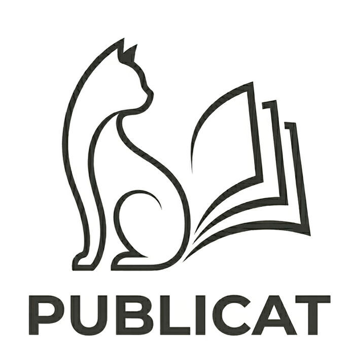

<div align="center">
  
  
  *A personalized AI-powered research feed that cuts through the noise and delivers only the methodology and discoveries you actually care about.*
</div>

---

> **Fewer papers, not a better-sorted pile.** Publicat's job is to hand you the handful of new papers you should not miss, and to earn your confidence that the rest can be skipped.

**PUBLICAT** is a highly-personalized, efficient triage system for managing daily scientific literature. 
Instead of manually sifting through hundreds of noisy arXiv preprints or generic keyword alerts, Publicat uses local vector embeddings and an explicit LLM judge to filter, score, and summarize the papers that match your specific research interests.

Streamline your academic reading into a manageable daily habit using **Inbox Zero** mechanics, complete with seamless Zotero RSS exports.

## Prerequisites: AI Models

Publicat uses a dual-stage filtering system. Stage 1 uses local vectors (which requires no setup), but Stage 2 relies on an LLM to accurately judge and summarize the papers. 

To use the Stage 2 LLM Reranking, you must have **one** of the following:
1. **[Ollama](https://ollama.com/)** installed and running locally on your machine (100% free and private).
2. **OR** an API Key from Anthropic (Claude) or Google (Gemini), which you can enter in the Settings menu after launching the app.

*(Note: If you don't have either, you can disable Stage 2 Reranking in the Settings menu, but the quality of your feed will be reduced).*

## Quick Start & Installation

**🎉 New in v1.0.1: We now support 1-Click zero-dependency installations!**

There are two ways to run Publicat: downloading the pre-packaged release, or cloning the repository manually.

### Option 1: 1-Click Install (Recommended)

This is the easiest way to run Publicat. You do **not** need Node.js or Docker installed!

1. Go to the [Releases page](https://github.com/jakob-steuer/publicat/releases).
2. Download the `publicat-release.zip` file for the latest version.
3. Extract the folder to your computer.
4. **Windows:** Double-click `start.bat`.
   **Mac/Linux:** Open a terminal in the folder and run:
   ```bash
   chmod +x start.sh
   ./start.sh
   ```

*What does this do?*
It automatically checks for and installs `uv` (a lightweight Python manager), creates an isolated virtual environment, installs PyTorch for your system (CUDA/MPS), and launches the pre-compiled app in your browser at `http://localhost:8001`!

### Option 2: Developer Git Install

If you want to pull updates via Git or modify the code, you will need **Node.js (v18+)** installed to build the frontend.

**For Mac/Linux:**
1. `git clone git@github.com:jakob-steuer/publicat.git`
2. Open a terminal in the folder and run:
   ```bash
   chmod +x start.sh
   ./start.sh
   ```

**For Windows:**
1. `git clone git@github.com:jakob-steuer/publicat.git`
2. Double-click the `start.bat` file.

### Docker
```bash
docker compose up --build
```
One image serves the API and the UI on `http://localhost:8001`; your data lives in the `publicat-data` volume. The image does not include PyTorch (Semantic Scholar supplies the embeddings), so it is small and starts fast.

### Manual Installation
Make sure you have Node.js (v18+) and Python (3.11+) with `uv` installed.
To install `uv` on Mac/Linux, you can run:
```bash
curl -LsSf https://astral.sh/uv/install.sh | sh
```

1. **Clone the repository:**
   ```bash
   git clone git@github.com:jakob-steuer/publicat.git
   cd publicat
   ```

2. **Start the Backend:**
   ```bash
   cd backend
   uv sync                 # add --extra local for optional on-device embeddings (PyTorch, ~2 GB; then set PUBLICAT_LOCAL_EMBEDDINGS=1)
   uv run uvicorn src.main:app --reload --port 8001
   ```
   Run the tests with `uv run pytest` (backend) and `npm run build` (frontend), or `make test` for both.

3. **Start the Frontend:** (In a new terminal window)
   ```bash
   cd frontend
   npm install
   npm run dev
   ```
   Open `http://localhost:8001` in your browser!

---

## Tutorial: Setting Up Your First Topic

Publicat uses AI to semantically match papers to your topics. The better you describe your topic, the better your initial feed will be!

**How ranking works:** every topic has its own small ranker, a logistic-regression model over the paper's Semantic Scholar SPECTER2 embedding plus a few readable features (keyword hits, followed authors, journal tier, preprint, LLM judge). Before you vote, it ranks by similarity to the topic vector, which is built from your **seed papers** (or, lacking those, from Semantic Scholar search results for the topic). Every Star (⭐), Upvote (👍), Neutral (➖) or Downvote (👎) retrains that topic's model within seconds and rescores its papers, so feedback is visible on the next feed load. Votes are attributed to exactly one topic, so topics never learn from each other's feedback. Click the score bubble on any card to see why it scored the way it did; the Settings page shows each ranker's vote counts and cross-validated accuracy. `Exclude keywords` are a hard filter.

### Head start from Zotero
In the topic form, **Start from a Zotero collection** lists your collections. Pick one and its papers become the topic's seed papers, with a suggested name and keywords that you can edit before creating the topic. One collection per research interest keeps the topics, and what they learn from your votes, separate. Needs the Zotero 7 desktop app with *Settings → Advanced → "Allow other applications on this computer to communicate with Zotero"*, or a Zotero user ID and read-only API key in Settings.

### Trying Publicat from scratch
A separate data directory is a separate, empty profile. Your real data is not touched:
```bash
PUBLICAT_DATA_DIR=~/publicat-fresh PUBLICAT_PORT=8002 ./start.sh
```

### Example LLM Prompt to Generate a Great Topic
If you're unsure how to describe your topic, ask an LLM of your choice:
> *"I want to create a feed for academic papers about [Your Topic]. Write a 2-3 sentence description focusing strictly on the methodology and core technologies involved, avoiding generic outcomes. Then provide a comma-separated list of 3-5 hyper-specific keywords."*

### Example Topic
- **Name:** Foundation Models in Life Sciences
- **Description:** Applications of large language models (LLMs), transformer architectures, foundation models, and self-supervised deep learning architectures applied to biological data.
- **Keywords:** Foundation Models, Protein Language Models, RNA Language Models, DNA Language Models

> **⚠️ Note:** When you create a new topic, Publicat will immediately start fetching and scoring papers from the last 30 days. This **first sync may take a few minutes** depending on your hardware and network speed.

---

## Using the Interface

The inbox is one ranked list per scope (all topics, one topic, or one author), with a reading pane. It is built for keyboard triage: `j`/`k` move, `Enter` opens the pane, `s` `u` `n` `d` vote, `z` undoes, `o` opens the article, `x` selects for bulk actions, `/` searches, `?` shows all shortcuts. After a vote the focus moves on, so a daily pass is a few keystrokes per paper. Filter chips narrow the list to Do-not-miss (score ≥ 90), this week, this month or followed authors; the sidebar shows unread counts per topic and holds the minimum-relevance slider. Your goal is to clear the inbox every day:

- ⭐ **Star (+2):** Save this paper. It will be permanently kept in your "Starred" feed for future reference, exported to your Zotero RSS feed, and heavily boosts similar papers in your future feed.
- 👍 **Upvote (+1):** Relevant paper, but you don't need to save it permanently. Boosts similar papers.
- ➖ **Neutral (0):** Clear it from the inbox. A slight "not for me" signal (a quarter of an upvote), so it is safe for papers you cannot judge yet.
- 👎 **Downvote / Discard (-1):** Not relevant. Hides the paper entirely and penalizes similar papers in the future.

### Features at a Glance
- **Daily wildcards:** three papers a day from just below your relevance threshold, marked as such. Your votes on them tell the ranker whether it was right to hide papers like that, which keeps it from narrowing into a filter bubble. Switch off in the sidebar.
- **Interruption-safe syncing:** every fetch looks back to the last *complete* sync (at least 3, at most 30 days), so a laptop that was closed for a week catches up. Writes are transactional; a run that lost requests is marked *partial* in Settings → Recent syncs and its period is fetched again next time. Only one sync runs at a time.
- **Automatic Cleanup:** To prevent database bloat, any publication older than 60 days that you haven't explicitly starred is automatically removed. Starred papers are kept forever!
- **Follow Authors:** Click the `+` icon next to an author's name on any paper. Every future paper they publish will automatically receive a score boost (+15%) and be highlighted in your feed!
- **High-Impact Journals:** Papers published in major life science and medical journals (like Nature, Science, Cell, NEJM) automatically receive a semantic score boost to ensure they surface in your feed.
- **Export Citations:** Easily export your starred papers to share or use in manuscripts.

### Zotero Integration
**One click, no API key:** with the Zotero desktop app running, the "Zotero" button in the reading pane (or in the bulk bar for a selection) saves the paper straight into the collection currently selected in Zotero, including the open-access PDF link and the AI summary as a note. Settings can turn on automatic saving of every starred paper.

**RSS fallback:** every topic also has a "Zotero RSS URL" button at the top of the inbox.

**How it works:**
1. Click the button to copy your unique topic URL.
2. In Zotero, go to *New Feed -> From URI* and paste the link.
3. High-confidence, AI-summarized papers will pipe straight into your reference manager!

*(We plan to add direct Zotero API key integration in the future. Pros: Direct PDF injection and two-way syncing. Cons: Requires giving the app full write access to your Zotero library.)*

---

## Where your data lives

Your papers, votes and settings are a single SQLite file in your user data directory, outside the app folder, so updating or re-cloning Publicat never touches them:

- macOS: `~/Library/Application Support/Publicat/publicat.db`
- Windows: `%APPDATA%\Publicat\publicat.db`
- Linux: `~/.local/share/publicat/publicat.db`

Older installations kept the database at `backend/publikater.db`; the first start copies it to the new location and leaves the old file untouched. Set `PUBLICAT_DATA_DIR` to use another folder, or `DATABASE_URL` for full control. Back up by copying that one file (while the app is stopped, or with `sqlite3 publicat.db ".backup copy.db"`).

## Semantic Scholar API Key (Highly Recommended)

> [!IMPORTANT]
> Publicat relies heavily on the Semantic Scholar API to discover new papers. While the app will run without an API key, the unauthenticated tier is heavily rate-limited globally. **Without a key, your paper fetching will likely fail with "Too Many Requests" errors.**

**How to get your free key:**
1. Go to [semanticscholar.org/product/api](https://www.semanticscholar.org/product/api)
2. Click "Get an API Key" and fill out the form.
3. Once you have your key, paste it into the **Settings** page inside the Publicat app.

---

## Local vs. Cloud AI

Publicat relies heavily on AI. All semantic embedding and paper matching runs **100% locally** on your machine using optimized PyTorch models. 

For generating the actual text summaries, you have a choice (configurable in Settings):
- **Cloud APIs (Recommended):** By entering a Gemini or Anthropic API key, Publicat can use extremely fast, cost-effective models (like Gemini Flash or Claude Haiku) to summarize dozens of complex papers in parallel in seconds with state-of-the-art accuracy. You only need to provide ONE API key.
- **Local (Ollama):** If you provide no API keys, Publicat automatically falls back to your local Ollama installation. While highly private, generating 20+ scientific summaries sequentially on a local 8B model will take significantly longer and requires powerful hardware.

---

## Legal & Tech Stack

**Tech Stack:** React, TypeScript, Vite, TailwindCSS • Python, FastAPI, SQLite • Semantic Scholar SPECTER v2, Gemini, Anthropic.

*This software is provided "as is", without warranty of any kind. It relies on third-party APIs (Semantic Scholar, arXiv, bioRxiv). AI-generated summaries may contain inaccuracies and should be verified against original publications.*

Copyright (c) 2026 Jakob Steuer. All rights reserved.
